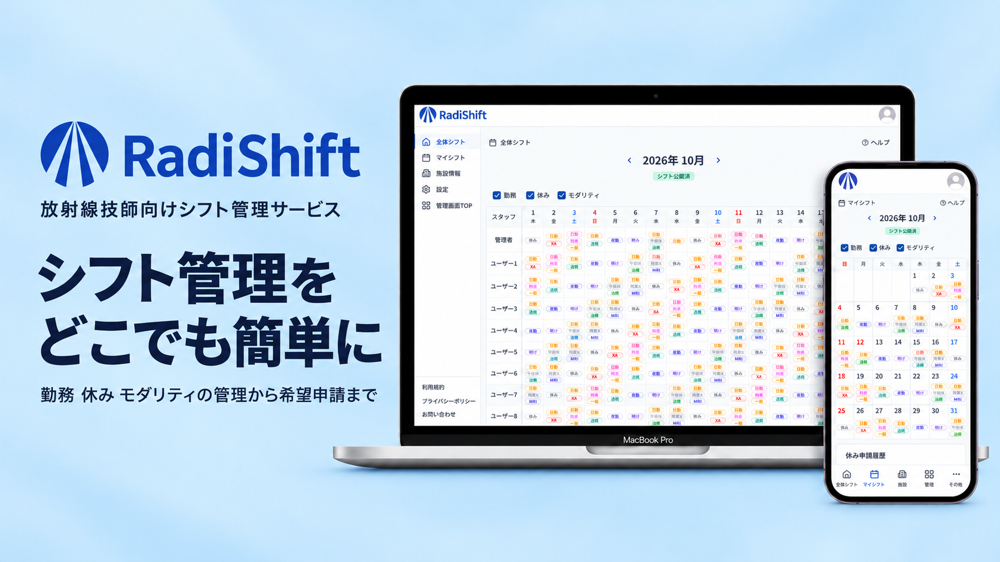
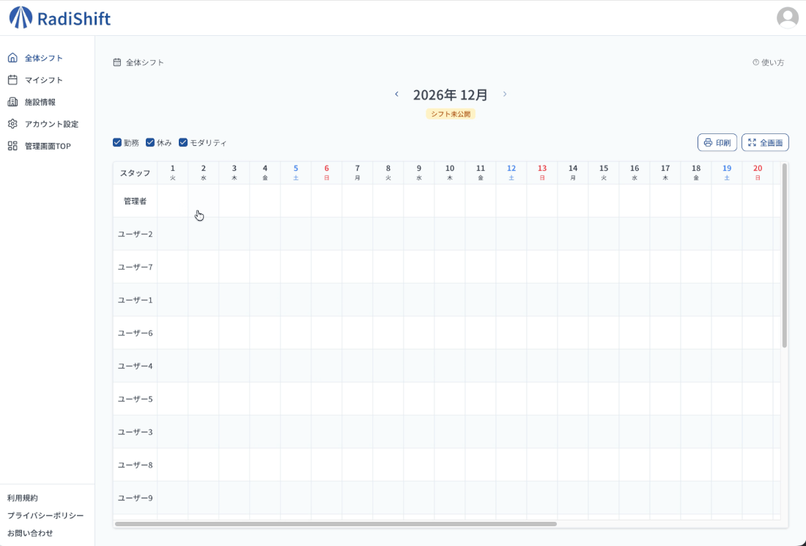
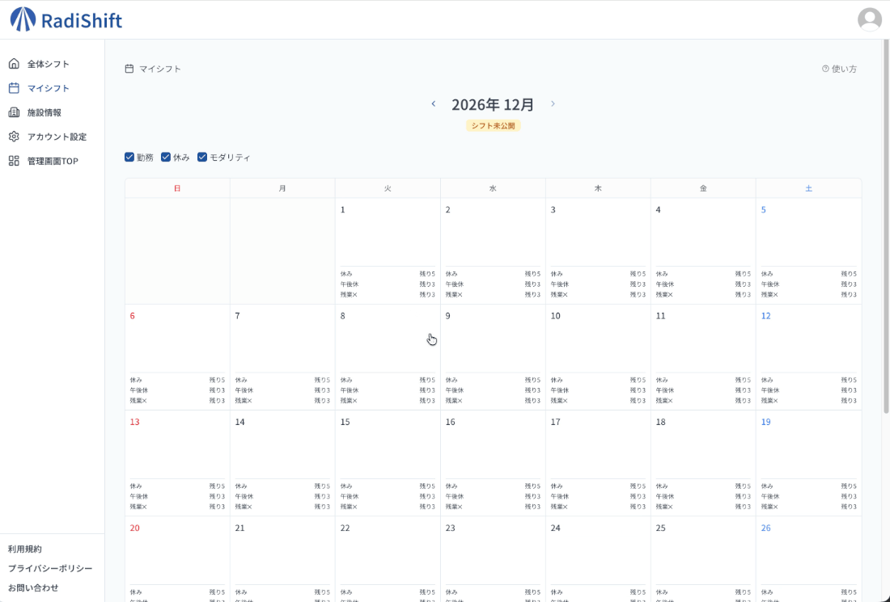
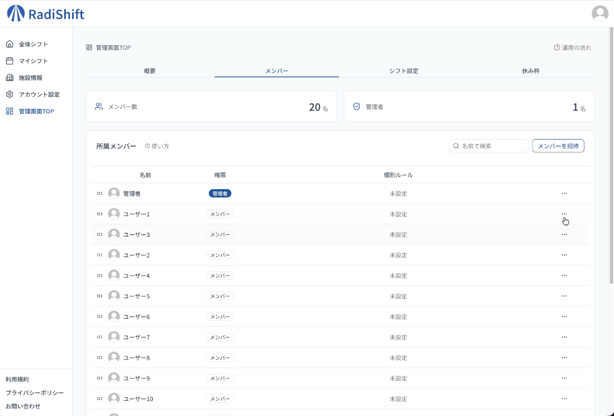
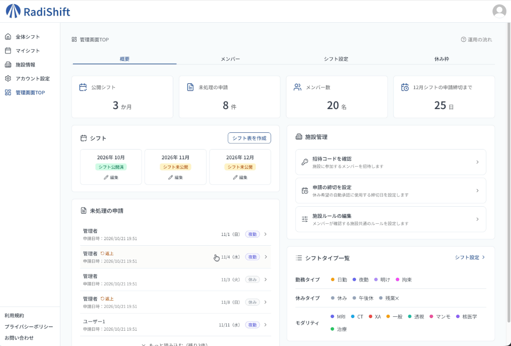
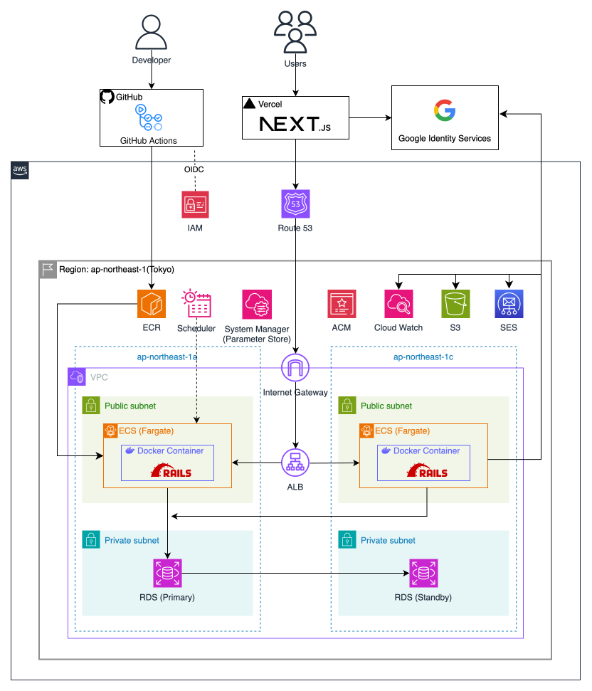
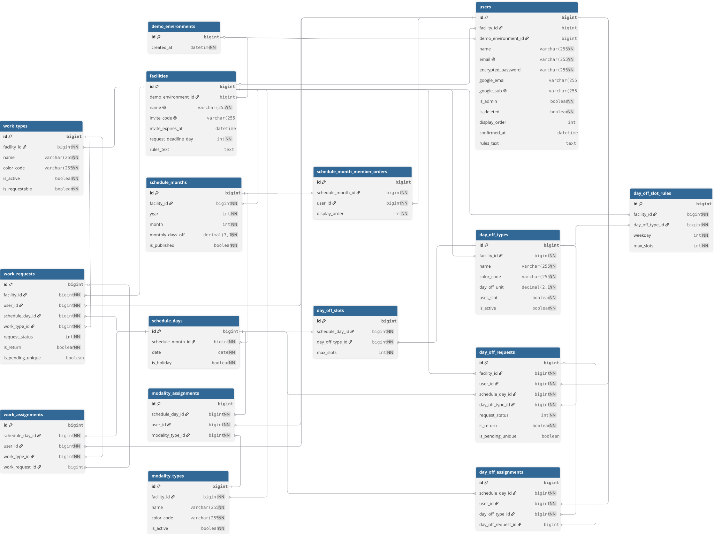

# RadiShift / 放射線技師向けシフト管理サービス

サービスURL: https://radi-shift.com

## サービス概要

RadiShiftは、**放射線技師のシフトをWeb上で確認・管理するためのシフト管理サービス**です。

施設全体のシフトを一覧で確認しながら、勤務・休み・モダリティを管理できます。

管理者は施設全体のシフトや各種設定を管理でき、メンバーは自分のシフトの確認や勤務・休みの希望申請を行えます。

また、施設で設定した休み枠に応じて希望休を自動承認でき、管理者のシフト管理業務の負担軽減を目指しています。

## 開発背景

私は現在、診療放射線技師として医療現場で勤務しています。

現在の職場では、休み希望を紙に記入して申請する必要があり、職場でしか申請できないことに不便さを感じていました。

また、シフト作成には病院内のパソコンでしか使用できないExcelを利用しているため、作業できる場所が限られています。さらに、紙で提出された休み希望を確認しながら、シフトを作成する作業にも手間がかかっています。

こうした日々の業務で感じた課題から、「場所を問わず休み希望を申請でき、シフトの作成・確認・管理までをWebで行えないか」と考えたことが、RadiShiftを開発したきっかけです。

紙やExcelを中心とした運用の不便さを解消し、いつでもどこでもシフトを扱いやすくなることを目指して、このWebサービスを開発しました。

## 主な機能

### 1. 施設全体のシフト管理

施設に所属するメンバーのシフトを月単位で一覧表示します。

勤務・休み・モダリティを同じシフト表から確認でき、管理者は日ごとの割当を編集できます。

また、シフトの作成・公開、印刷、表示項目の切り替えにも対応しています。

### 2. マイシフト

メンバーは、自分の勤務・休み・担当モダリティを月単位で確認できます。

勤務や休みの希望申請、シフトの返上申請にも対応しており、申請状況や過去の申請履歴も確認できます。

### 3. 施設・メンバー管理

施設の作成や招待コードによる施設参加に対応しています。
管理者は、メンバーの管理者権限の設定、個別ルールの登録、表示順の変更などを行えます。
また、施設情報や施設ルールの確認・編集にも対応しています。

### 4. シフト設定と申請管理

管理者は、施設の運用に合わせてシフトに関する設定を行えます。
勤務・休み・モダリティの種類や、曜日・祝日ごとの休み枠、希望申請の締切などを設定できます。
設定した休み枠に空きがあり、申請締切日までであれば、メンバーからの休み希望を自動で承認し、シフトに反映できます。 これによって管理者が申請を一件ずつ確認する手間を減らせます。
また、自動承認の対象とならない申請については、管理者が承認・否認を行えます。

このほか、Google認証やメール認証、パスワード再設定、プロフィール画像の登録など、アカウント管理に必要な機能も実装しています。

## デモ機能

RadiShiftには、**アカウント登録なしで主要機能を確認できるデモ機能**があります。

本番トップページの「デモを試す」を押すと、デモ専用のデータが作成され、管理者としてRadiShiftを操作できます。

デモを利用するために、以下の操作は必要ありません。

- アカウント作成
- メール認証
- 施設作成
- 初期シフトデータの登録

デモ環境には、施設・メンバー・勤務・休み・モダリティ・シフト・申請データなどがあらかじめ用意されます。

そのため、RadiShiftの主要な操作をすぐに確認できます。

## 使用技術

| カテゴリ | 技術 |
| --- | --- |
| Frontend | Next.js 16.4.2 / React 19.2.3 / TypeScript 5.9.3 |
| UI | Tailwind CSS 4.2.1 / shadcn/ui |
| Backend | Ruby 3.3.13 / Ruby on Rails 8.1.4 |
| Database | MySQL 8.4 |
| Authentication | Devise 5.0.4 / devise-jwt 0.13.0 / Google Identity Services |
| Storage | Amazon S3 |
| Mail | Amazon SES |
| Infrastructure | Vercel / AWS ALB / ECS Fargate / ECR / RDS |
| Development | Docker / Docker Compose |
| CI/CD | GitHub Actions / GitHub OIDC |
| Test / Quality | RSpec / RuboCop / ESLint / Prettier / TypeScript型チェック / Next.js本番ビルド |

 
 
## 技術選定理由

RadiShiftでは、PCやスマートフォンからシフトを簡単に確認・申請できるように操作性を重視して技術を選定し、個人開発でも効率よく機能を追加・改善できるように開発のしやすさやコードの保守性、セキュリティも考慮しています。

また、Web開発への理解を深めるため、フロントエンド、バックエンドからインフラ、CI/CDまで幅広く経験できる技術構成を採用しました。

### フロントエンド：React / Next.js / TypeScript

**採用理由**
- Reactは利用者が多く、UIコンポーネントやライブラリが充実しているため
- Next.jsはReactをベースに、Server Componentsやルーティングなどの機能があり、サーバー処理とクライアント処理を効率的に実装できるため
- Next.js 16のCache ComponentsとSuspenseを利用し、シフトデータの読み込み中でも画面の一部を先に表示できる点に魅力を感じたため
- TypeScriptによって複雑なシフトデータの型安全性を高め、自動補完により開発時のミスを減らせるため

### バックエンド：Ruby / Ruby on Rails

**採用理由**
- Railsチュートリアルなどの学習教材が充実しており、プログラミング初学者でも学びやすいと考えたため
- Railsにはあらかじめ決められた設計ルールがあり、細かな設定を自分で行う必要が少なく、開発を進めやすいと考えたため
- DeviseやRSpecなどのライブラリが充実しており、認証やテストの実装をしやすいため

### UI：Tailwind CSS / shadcn/ui

**採用理由**
- Tailwind CSSは細かなデザイン調整やレスポンシブ対応を効率的に行えるため
- shadcn/uiはシンプルで使いやすいUIコンポーネントが用意されており、ユーザーが操作しやすい画面を作れると感じたため
- 必要なコンポーネントだけを追加でき、ソースコードも自由に変更できるため、RadiShiftに合ったデザインへ調整しやすいため

### データベース：MySQL

**採用理由**
- MySQLは多くのWebアプリケーションで利用されており、今後の実務にも役立つ技術だと考えたため
- Railsとの連携がしやすく、トランザクションや行ロックに対応しており、複数のユーザーが同時に休み希望を申請する場合でも、データの整合性を保つ仕組みを実装できるため

### 認証：Devise / devise-jwt

**採用理由**
- RailsのDeviseと組み合わせることで、メール認証やパスワード再設定などの機能を一から実装することなく利用できるため
- devise-jwtはAPI通信のたびにトークンを更新する必要がなく、認証処理をシンプルに実装できると考えたため

### 開発環境：Docker / Docker Compose

**採用理由**
- OSやローカル環境の違いによる動作の差を減らし、開発環境を再現しやすくするため
- Docker Composeで複数のコンテナをまとめて起動・管理できるため

### CI/CD：GitHub Actions

**採用理由**
- 普段からコード管理に使用しているGitHubと連携しやすく、テストやデプロイを自動化できるため

### インフラ：Vercel / AWS

**採用理由**
- AWSではコンテナ・データベース・画像保存・メール配送など、それぞれの役割に合ったサービスを組み合わせられるため
- 実務で採用されているAWSでのインフラを構築することで、ネットワークやセキュリティ、デプロイなど、Webアプリを運用するための知識も身につけたいと考えたため
- VercelはNext.jsの開発元が提供しているサービスであり、Next.jsの機能を活かしながら、少ない設定でデプロイできるため
- VercelはGitHubと連携した自動デプロイやPreview環境、CDNなどの機能が用意されており、開発・運用の負担を減らせるため

## インフラ構成図

## ER図

## 工夫した点

### 1. 医療現場に合わせた業務ロジック・データ設計

#### 放射線技師の業務に合わせたモダリティ管理

一般的なシフト管理では勤務や休みを中心に管理しますが、放射線技師の業務では、レントゲン・CT・MRIなど、担当モダリティも管理する必要があります。
そこで、放射線技師の業務に合わせて、勤務・休みだけでなくモダリティも管理できる機能を実装しました。
勤務・休み・モダリティをそれぞれ独立したデータとして管理し、同じシフト表にまとめて表示することで、誰が勤務するかだけでなく、誰がどのモダリティを担当するかも一覧で確認できるようにしています。

#### 休み枠の自動作成と希望休の自動承認

医療現場では、曜日や祝日によって休みを取得できる人数が異なることがあります。また、提出された休み希望を管理者が一件ずつ確認する作業にも手間がかかります。
そこで、施設ごとに曜日・祝日別の休み枠を設定できるようにし、シフト表の作成時に各日付の休み枠を自動生成する仕組みを実装しました。
休み希望の申請時には、Rails API側で休み枠の空き状況と申請締切を確認し、締切日までに申請され、休み枠に空きがある場合は自動承認してシフトに反映します。締切日を過ぎた申請は管理者の承認待ちとし、休み枠の上限に達している場合は申請できないようにしています。
これにより、施設で設定したルールを守りながら、管理者の承認作業を減らせるようにしています。

また、休みの種類ごとに休み枠を使用するかどうかを設定できるようにし、施設の運用に合わせて自動承認の対象を変更できるようにしています。
休み日数も0.5日単位で設定できるため、午前休や午後休などにも対応しています。
自動作成した休み枠は日付ごとに変更できるため、後から特定の日だけ休み枠を調整することもできます。

#### 申請由来の割当を保護する仕組み

RadiShiftでは、本人の希望申請から作成された割当と、管理者が直接設定した割当を区別して管理しています。
本人の申請による勤務・休みの割当は、管理者が通常の編集操作で変更・削除できないようにしています。
管理者が変更する必要がある場合には、明示的に管理者管理へ切り替える操作を用意しました。
これにより、本人の希望申請が誤って変更されることを防ぎながら、必要に応じて管理者がシフトを調整できるようにしています。

#### トランザクションと行ロックによる同時申請対策

休み希望の申請では、同じ日に複数のユーザーが同時に申請した場合でも、設定された休み枠の上限を超えないようにする必要があります。
そのため、RailsのトランザクションとMySQLの行ロックを利用しています。
対象データをロックした状態で休み枠の残数を確認し、申請を処理することで、同時申請によるデータの不整合を防ぐようにしています。

#### シフト公開状態に応じたAPIのデータ制御

シフト作成中の勤務情報が一般メンバーに見えてしまわないよう、公開状態に応じてRails APIから返すデータを制御しています。
公開前は本人の申請に由来する勤務・休みの割当だけを返し、管理者が設定した割当やモダリティは返さないようにしています。
また、一般メンバーが未公開の全体シフトを取得できないよう、API側でも制限しています。
画面上で非表示にするだけでなく、必要なデータだけを返すことで、公開前のシフト情報を適切に管理できるようにしました。

#### 公開済みシフトの表示順を維持する仕組み

管理者がメンバーの表示順を変更しても、過去に公開したシフト表の表示順が変わらないように工夫しました。
シフト公開時に、その月のメンバー表示順をデータベースに保存しています。
これにより、施設のメンバー表示順を変更しても、公開済みシフトでは公開時の並び順を維持できるようにしました。

#### 施設脱退時のシフトデータ管理

メンバーが施設から脱退した場合でも、過去の勤務状況を確認できるように、シフトデータの扱いを工夫しました。
脱退したメンバーの過去月・当月の割当は残し、翌月以降の割当だけを削除するようにしています。
これにより、今後のシフトには影響を与えず、過去の勤務記録を確認できるようにしました。

### 2. 認証・セキュリティ

#### 施設ごとのデータ分離とアクセス制御

RadiShiftでは、施設ごとにメンバーやシフトなどのデータを管理しています。
Rails APIでは、ログインユーザーが所属する施設のデータを取得するようにし、他施設のデータにアクセスできないようにしています。
また、一般メンバーと管理者で操作できる範囲を分け、シフトの編集や施設設定などは管理者のみが行えるようにしています。
画面上の表示制御だけでなく、Rails API側でも権限を制御することで、不正な操作を防ぐようにしています。

#### JWTによる認証情報の安全な管理

Railsで発行したJWTは、Next.jsサーバー側でhttpOnly Cookieに保存しています。
これにより、ブラウザのJavaScriptからJWTを直接読み取れないようにし、XSSによる認証情報の盗み取りリスクを減らしています。
また、本番環境ではSecure属性によってHTTPS通信に限定し、SameSite属性によって一部のCSRF攻撃への対策も行っています。
Rails APIへの通信ではNext.jsサーバー側からJWTを送信し、ブラウザ側で認証情報を直接扱う必要がない構成にしています。

#### Google認証も既存のJWT認証へ統合

メールアドレスとパスワードによる認証に加え、Google認証にも対応しています。
Google Identity Servicesから取得したID TokenをRails側で検証し、ユーザーを特定した後は、既存のDevise / devise-jwtでJWTを発行しています。
認証方法が異なってもログイン後の処理を共通化することで、認証方法ごとに別のセッション管理を実装する必要がない構成にしています。

### 3. パフォーマンス・ユーザー体験

#### Next.jsのキャッシュを利用したデータ取得

シフト月やメンバー情報など、繰り返し取得するデータにはNext.jsの`use cache: private`を利用しています。
また、Server Actionsでデータを変更した際には`updateTag()`を使い、関連するキャッシュを更新しています。
これにより、不要なデータ取得を減らしながら、更新後は変更内容を画面に反映できるようにしています。

#### 訪問者ごとに分離されたデモ環境

ポートフォリオを確認する人が、アカウント登録や施設の初期設定を行わずに操作を体験できるよう、デモ機能を実装しました。
デモ開始時には、専用の施設・メンバー・シフトなどのサンプルデータを自動生成し、管理者としてログインできるようにしています。
また、デモ利用者ごとに別の環境を作成することで、他の利用者のデータに影響を与えずに操作を試せるようにしています。
デモ環境には24時間の有効期限を設け、期限切れのデモユーザーによる利用を制限しています。

### 4. CI/CD・運用

#### GitHub ActionsによるCI/CD

GitHub Actionsを利用し、Pull Request時にRSpec・RuboCop・ESLint・Prettier・TypeScript型チェック・Next.js本番ビルドを実行しています。
また、mainへのpush時には、バックエンドまたはCD設定に変更がある場合にCIを実行し、成功した場合のみ本番バックエンドをデプロイする構成にしています。
GitHub OIDCを利用することで、長期間有効なAWSアクセスキーをGitHubに保存せずに認証しています。
デプロイ時には、ECSの一時タスクで`rails db:migrate`を実行し、正常終了した場合にECS Serviceを更新する構成にしています。
